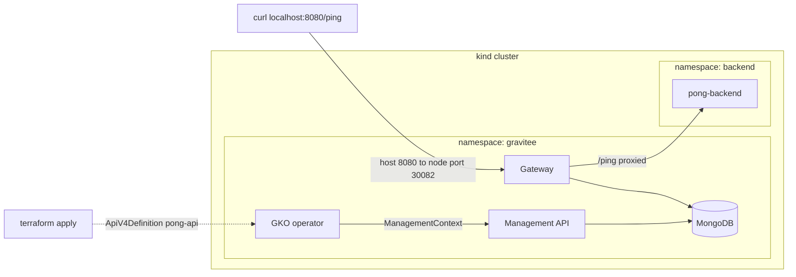

# pong-gravitee

Gravitee API Management (Community Edition) on a local kind cluster.
`GET /ping` through the gateway returns `pong`.

Tested on: Windows 11 with Docker Desktop (WSL2). Not yet tested on macOS or Linux.

## What gets deployed

| Component | Purpose |
|---|---|
| kind cluster | Local Kubernetes, one node |
| MongoDB (official image, auth on, 1 Gi volume) | Repository for the Management API and the gateway rate-limit store |
| Gravitee Management API + Gateway | Holds API definitions and serves traffic. Console, Portal and Elasticsearch are off |
| Gravitee Kubernetes Operator (GKO) | Pushes API definitions from Kubernetes into the Management API |
| `pong-backend` | Small Python server. `GET /ping` returns `pong` |
| `ApiV4Definition` `pong-api` | The `/ping` route on the gateway, proxied to `pong-backend` |

It follows the GKO guides:
[quickstart](https://documentation.gravitee.io/gravitee-kubernetes-operator-gko/getting-started/quickstart-guide) and
[install with Helm](https://documentation.gravitee.io/gravitee-kubernetes-operator-gko/getting-started/installation/install-with-helm).

## Prerequisites

Required:

| Tool | Windows | macOS | Linux |
|---|---|---|---|
| Docker, running | Docker Desktop (WSL2) | Docker Desktop | Docker Engine, your user in the `docker` group |
| Terraform 1.6+ | `winget install Hashicorp.Terraform` | `brew install hashicorp/tap/terraform` | HashiCorp apt or yum repository |
| Python 3.9+ | `winget install Python.Python.3.12` | `brew install python` | usually installed |

Optional, only to look inside the cluster (Terraform creates the cluster with its own providers, so none of these is needed to run the stack):

| Tool | Use |
|---|---|
| `kubectl` | Inspect pods, logs and the `ApiV4Definition` |
| `helm` | `helm list -A` to see the releases |
| `kind` | `kind get clusters` |

Give Docker 4 CPUs and 6 GB of memory. Host port 8080 must be free. The first run pulls a few GB of images, so allow several minutes.

## Run it

Windows (PowerShell):

```powershell
python run.py up
python run.py test
curl.exe http://localhost:8080/ping
python run.py down
```

macOS and Linux:

```bash
python3 run.py up
python3 run.py test
curl http://localhost:8080/ping
python3 run.py down
```

| Command | What it does |
|---|---|
| `up` | `terraform init`, `terraform apply` (retried once if it fails), then waits for `/ping` to return `pong`. The cluster keeps running |
| `test` | Calls `/ping` through the gateway. Passes only if the body is exactly `pong` |
| `down` | `terraform destroy`. Removes the cluster and everything in it |

`up` can be run again at any time. Terraform changes only what differs.

## Architecture



Request path: `curl` to host port 8080, kind maps it to the gateway NodePort 30082, the gateway matches the `/ping` flow and proxies to the `pong-backend` Service, which answers `pong`.

Setup path: Terraform applies the `ApiV4Definition`. GKO pushes it to the Management API. The gateway loads it from there.

## Repository layout

```
run.py                              up | test | down
backend/
  app.py                            GET /ping -> pong, GET /healthz for probes
  gravitee/pong-api.yaml            ApiV4Definition: route, backend target, keyless plan
terraform/
  terraform.tfvars                  the file to edit: versions, ports, sizes, Helm values
  variables.tf                      variable definitions and checks
  versions.tf, providers.tf         providers and cluster connection
  cluster.tf                        kind cluster, port mapping, namespaces
  mongodb.tf                        MongoDB StatefulSet, Secrets, generated passwords
  apim.tf                           Management API + Gateway (Helm)
  gko.tf                            GKO (Helm), ManagementContext, applies pong-api.yaml
  backend_app.tf                    backend ConfigMap, Deployment, Service
  outputs.tf                        ping_url, kubeconfig_path
  gravitee/management-context.yaml.tftpl
DEVELOPER.md                        how the code works, for reviewers
```

The route file sits next to the backend because the backend owns its contract. The `ManagementContext` is platform wiring, so it stays under `terraform/`.

## Configuration

Everything is set in `terraform/terraform.tfvars`: cluster name, ports, chart and image versions, resources, the MongoDB settings, and the full Helm values for the apim and gko releases (`apim_values`, `gko_values`). Terraform passes them through unchanged.

| You change | What happens on the next `up` |
|---|---|
| `backend/gravitee/pong-api.yaml` | GKO updates the API in the Management API. No pod restarts |
| `backend/app.py` | The ConfigMap changes and the backend pod restarts (the source hash is on the pod) |
| `apim_values` or chart versions | Helm upgrades the release and the chart restarts its pods. The wait before the API is applied runs again |
| `gateway_host_port` | The kind port mapping changes, which recreates the cluster |

Passwords for MongoDB are generated by Terraform and kept in Kubernetes Secrets. They are not in any file in this repository.

## Assumptions

- "Whatever the gateway needs to get its API configuration" is read as a Management API with a database. The GKO quickstart expects one, so MongoDB is included.
- One command means `python run.py up`. The only prerequisites are Docker, Terraform and Python.
- Local, single node, plain HTTP. HTTPS and certificate renewal are optional in the brief and not included.
- The `/ping` route uses the keyless plan, since the brief asks for a plain `GET /ping`.
- Community Edition only. No Console, Portal or Elasticsearch.
- The Management API keeps the chart's default `admin` login and is reachable only inside the cluster.

## Choices and alternatives

| Decision | Chosen | Considered | Why |
|---|---|---|---|
| Cluster | kind | minikube, k3d | Runs in Docker, which is already a prerequisite. Terraform has a kind provider |
| Provisioning | Terraform | kind CLI + Helm + kubectl scripts, Helmfile | One state, one `apply`, one `destroy`, no extra CLIs on the host |
| Entry point | `python run.py` | Makefile, shell scripts | Works the same on Windows, macOS and Linux. Standard library only |
| API config | GKO with an `ApiV4Definition` | Calling the Management API directly, DB-less gateway with local definitions | Declarative, matches the GKO quickstart, lives next to the backend |
| Database | MongoDB on the official `mongo` image | Bitnami chart, Gravitee's bundled chart, PostgreSQL | Bitnami's Docker Hub image only has a floating `latest` tag, and Gravitee's own chart now points at `bitnamilegacy`. The official image has fixed tags and amd64 and arm64 builds |
| Access from host | NodePort + kind port mapping | Ingress controller | No extra controller. Fewer moving parts for one route |
| Backend delivery | Source in a ConfigMap on `python:3.12.7-alpine` | Build and push an image | No registry or build step. See next steps |
| GKO resources | `kubectl` provider | `kubernetes_manifest` | `kubernetes_manifest` checks the CRD schema at plan time and fails on a new cluster, before GKO has installed its CRDs |

## Security in this setup

- MongoDB authentication is on. Gravitee connects with a user limited to its own database, not with root.
- The connection string is passed from a Secret, not through a ConfigMap or the Helm values.
- The backend namespace enforces the Pod Security `restricted` level. The pod runs as non-root with a read-only root filesystem, all capabilities dropped and no service account token.
- The `gravitee` namespace audits against `restricted`. It does not enforce it, because it runs third-party charts that I have not checked against that level.
- Chart versions, image tags and provider versions are pinned.

## Metrics

The gateway exposes Prometheus metrics on its technical API, port 18082. To look at them:

```bash
kubectl -n gravitee port-forward deploy/gravitee-apim-gateway 18082:18082
curl -u admin:adminadmin http://localhost:18082/_node/metrics/prometheus
```

The credentials are the chart's defaults. No Prometheus is deployed here.

What I would watch:

- Request rate, 4xx and 5xx rate, and p95/p99 latency at the gateway. These are the first signs of a broken route or a slow backend.
- Gateway JVM heap, garbage collection time and CPU against the pod limit.
- Pod restarts and readiness for the gateway, Management API, GKO, MongoDB and the backend.
- GKO sync errors, for example `ApiV4Definition` resources that are not accepted.
- MongoDB availability and volume usage. Without it neither the Management API nor rate limiting works.

## What is missing before production, and next steps

| Gap | What I would do |
|---|---|
| No TLS | cert-manager with a local CA here and ACME in production, plus a TLS listener on the gateway |
| Management API uses the default `admin` login; the technical API uses `admin`/`adminadmin` | Replace with OIDC or a generated, hashed password from a secret store. Set the technical API password |
| Generated passwords are stored in Terraform state | Remote, encrypted state with locking. External Secrets or Vault so state does not hold secrets |
| One MongoDB instance on one volume | Replica set, backups, restore test |
| One replica of everything | Two or more gateway replicas, a HorizontalPodAutoscaler, PodDisruptionBudgets. They need more than one node to mean anything |
| No NetworkPolicies | Allow only gateway to backend, GKO to Management API, and Gravitee to MongoDB. kind's default network plugin may not enforce them, so test on a real CNI |
| `gravitee` namespace is not enforced | Move to `baseline`, then `restricted`, after checking each chart's pods |
| Backend source in a ConfigMap | Build, scan, sign and push a versioned image in CI and pin it by digest |
| No monitoring stack or alerts | Prometheus with a ServiceMonitor, and alerts on the signals above |
| No CI | `terraform fmt -check`, `terraform validate` and `python run.py test` on Windows, macOS and Linux runners |
| Lock file | Run `terraform providers lock` for all platforms and commit the result |

## Troubleshooting

```bash
export KUBECONFIG=terraform/.kube/pong-gravitee.kubeconfig     # PowerShell: $env:KUBECONFIG="terraform\.kube\pong-gravitee.kubeconfig"
kubectl get pods -A
kubectl -n gravitee logs deploy/gravitee-apim-api
kubectl -n gravitee logs deploy/gravitee-apim-gateway
kubectl -n gravitee logs deploy/graviteeio-gko
kubectl -n gravitee get apiv4definitions
kubectl -n gravitee describe pod gravitee-mongodb-0
```

- **`connection refused` when applying `pong-api`:** the Management API was still starting. `run.py` retries once. If it still fails, run `up` again or raise `api_apply_delay`.
- **404 from the gateway for `/ping`:** check `kubectl -n gravitee get apiv4definitions` and the GKO logs.
- **Empty reply on port 8080:** check that the gateway Service is a `NodePort` mapped to 30082 (`kubectl -n gravitee get svc`) and that it has endpoints (`kubectl -n gravitee get endpoints`).
- **State and cluster out of step after an interrupted run:** the cluster is disposable. Run `down`, then `up`.
- **Docker is not running** or **port 8080 is in use:** `run.py` and Terraform stop with a message. Fix it and run `up` again.
